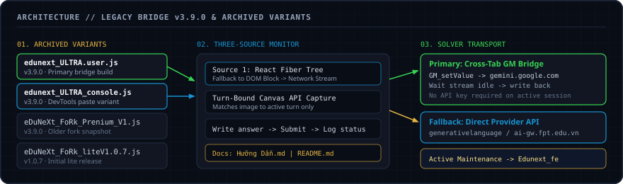
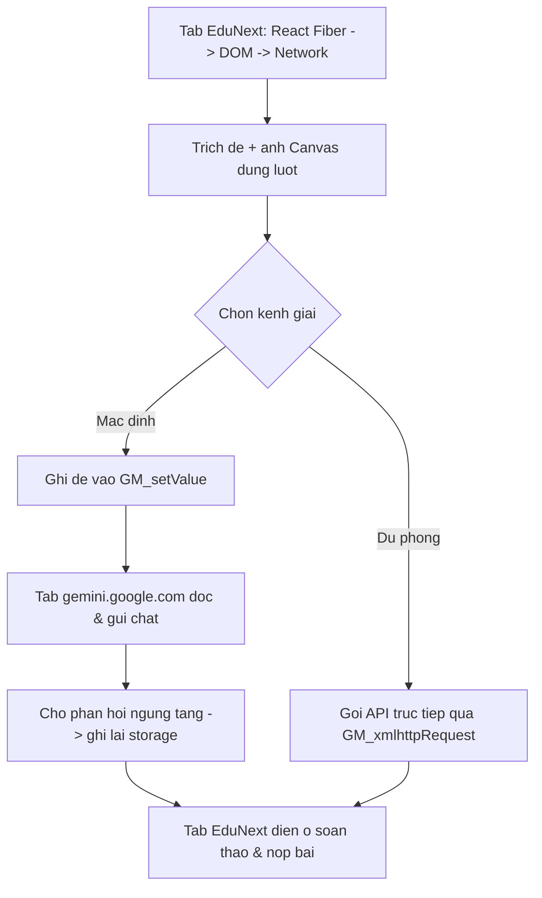

  

  
  
  

Kho lưu trữ các phiên bản EduNext userscript đời đầu và nhánh cầu nối (`Bridge v3.9.0`). Phiên bản đang duy trì và vá lỗi mới nhất nằm tại [Edunext_fe](https://github.com/broamstuck-cybr/Edunext_fe).

---

## Mục lục

- [Tổng quan](#tổng-quan)
- [Kiến trúc cầu nối](#kiến-trúc-cầu-nối)
- [Cấu trúc tệp trong repo](#cấu-trúc-tệp-trong-repo)
- [Yêu cầu môi trường](#yêu-cầu-môi-trường)
- [Cài đặt và sử dụng](#cài-đặt-và-sử-dụng)
- [Phạm vi và giới hạn](#phạm-vi-và-giới-hạn)
- [Giấy phép](#giấy-phép)

---

## Tổng quan

Nhánh `edunext-legacy` tập trung vào hướng giải bài không cần API key trả phí bằng cách chuyển câu hỏi sang một tab `gemini.google.com` đang đăng nhập sẵn thông qua `GM_setValue` và `GM_addValueChangeListener`. Khi bản mới hơn tách sang [Edunext_fe](https://github.com/broamstuck-cybr/Edunext_fe) với gói đóng gói và cơ chế xử lý sự kiện cập nhật hơn, các bản `ULTRA` và `FoRk` trước đó được giữ nguyên tại đây để đối chiếu và tra cứu.

---

## Kiến trúc cầu nối

  

1. **Giám sát từ 3 nguồn độc lập:** Các bản `v3.9.0` đọc trạng thái câu hỏi theo thứ tự dự phòng `React Fiber -> khối DOM -> luồng mạng`, tránh bỏ sót khi giao diện render lại.
2. **Gắn ảnh `<canvas>` theo đúng lượt:** Ảnh đề lấy từ API canvas được gắn theo lượt câu hỏi hiện tại để tránh lấy nhầm ảnh của câu trước đó.
3. **Truyền nhận liên tab:** Tab EduNext ghi yêu cầu vào storage dùng chung; tab `gemini.google.com` tự điền khung chat, chờ phản hồi ngừng sinh chữ rồi đẩy kết quả ngược về tab bài học.

---

## Cấu trúc tệp trong repo

| Tệp | Phiên bản header | Trạng thái |
| --- | --- | --- |
| `edunext_ULTRA.user.js` | `3.9.0` | Bản userscript chính trong kho lưu trữ, dùng cầu nối tab Gemini |
| `edunext_ULTRA_console.js` | `3.9.0` | Bản dán console tương ứng dòng ULTRA |
| `eDuNeXt_FoRk_Prenium_V1.js` | `3.9.0` | Bản fork cũ hơn trước khi chuẩn hoá tên tệp |
| `eDuNeXt_FoRk_liteV1.0.7.js` | `1.0.7` | Bản Lite đầu tiên lưu trữ nguyên trạng |
| `Hưỡng Dẫn.md` | - | Ghi chú cài Tampermonkey và tạo Google AI Studio key cũ |
| `.gitleaks.toml` | - | Cấu hình allowlist cho hằng chữ ký legacy khi quét bảo mật |

---

## Yêu cầu môi trường

- Trình duyệt Chromium (Chrome, Brave, Edge) đã bật **Developer Mode** trong mục quản lý extension.
- **Tampermonkey** hoặc **Violentmonkey** để dùng `GM_setValue` và `GM_addValueChangeListener` liên tab.
- Một tab `https://gemini.google.com` đang đăng nhập sẵn (nếu dùng tuyến cầu nối) hoặc API key (nếu dùng tuyến API trực tiếp).

---

## Cài đặt và sử dụng

1. Mở [edunext_ULTRA.user.js](edunext_ULTRA.user.js) rồi bấm **Raw** để Tampermonkey nhận diện và cài đặt.
2. Mở một tab `https://gemini.google.com` và đăng nhập tài khoản Google của bạn.
3. Mở bài học trên `https://fsc-edunext.fpt.edu.vn` hoặc `https://edunext.fpt.edu.vn`, sau đó dùng các phím tắt sau:

| Tổ hợp | Chức năng |
| --- | --- |
| `Ctrl + E` | Mở hoặc đóng bảng điều khiển |
| `Ctrl + Shift + E` | Phím dự phòng khi trang web giữ `Ctrl + E` |
| `Ctrl + Shift + X` | Dừng khẩn cấp vòng lặp |
| `Esc` | Đóng bảng điều khiển đang mở |

Xem thêm hướng dẫn sơ khai tại [Hưỡng Dẫn.md](H%C6%B0%E1%BB%A1ng%20D%E1%BA%ABn.md).

---

## Phạm vi và giới hạn

- Kho này chỉ mang tính lưu trữ; nhiều bản vá về CSP, sự kiện click và định dạng đáp án chỉ có bên [Edunext_fe](https://github.com/broamstuck-cybr/Edunext_fe).
- Tuyến cầu nối phụ thuộc hoàn toàn vào selector DOM hiện tại của `gemini.google.com` và trạng thái đăng nhập của tab phụ.
- Bản dán console (`edunext_ULTRA_console.js`) giữ header userscript trong phần đầu tệp nhưng khi chạy ngoài Tampermonkey sẽ không có `GM Storage` liên tab.
- Các bài dạng video hoặc thao tác bên ngoài khung chat sẽ khiến vòng lặp tự dừng.

---

## Giấy phép

Kho lưu trữ này hiện chưa có tệp `LICENSE` riêng; toàn bộ tệp được giữ lại cho mục đích tham khảo lịch sử phát triển cá nhân.
